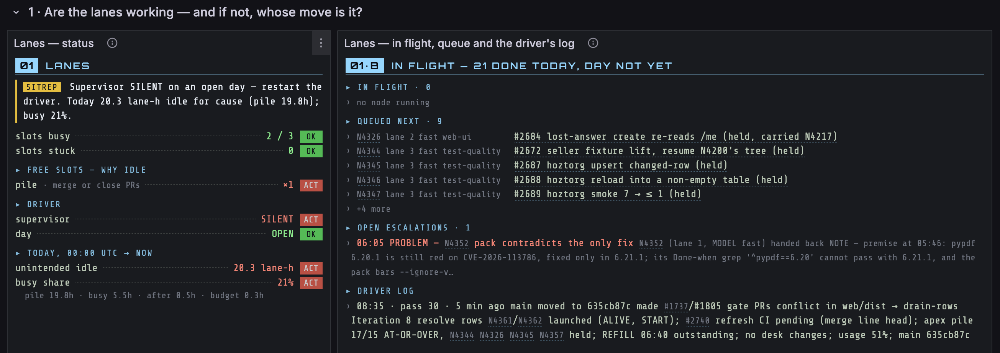
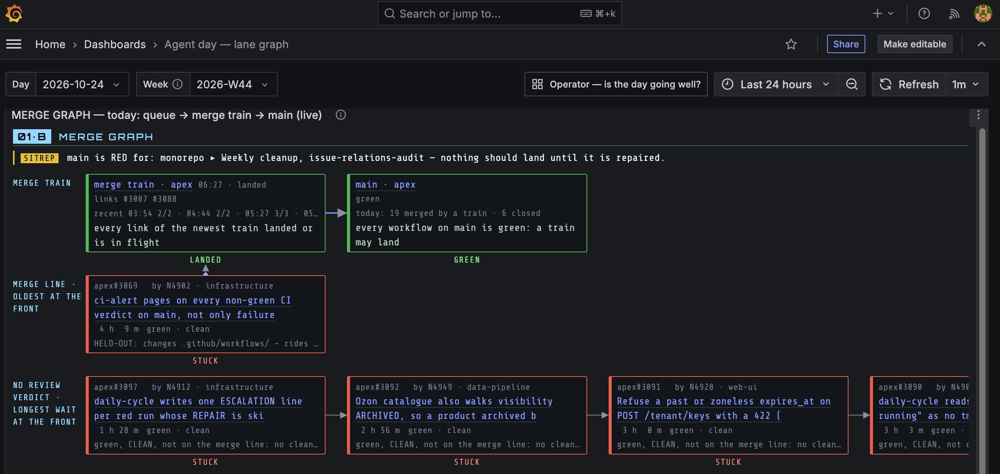
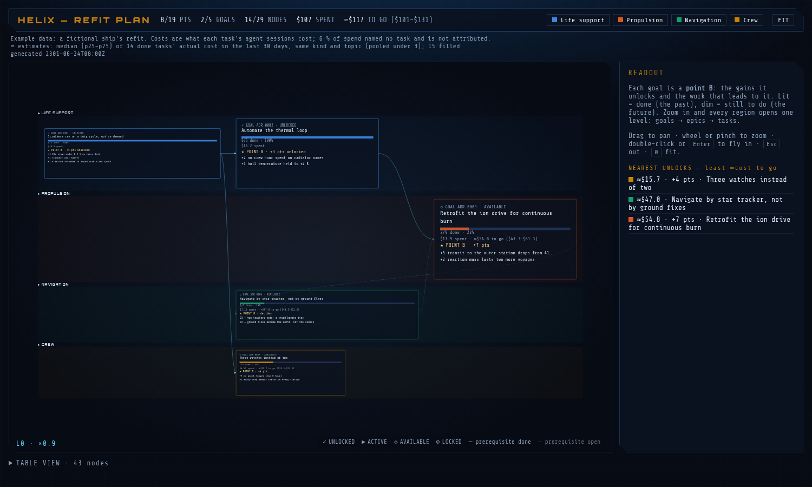
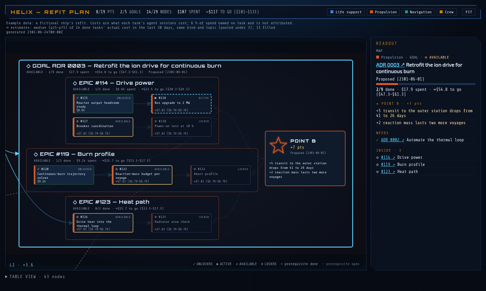

# eakot-mp

A [Claude Code plugin marketplace](https://docs.claude.com/en/docs/claude-code/plugin-marketplaces) of things
worth sharing. Every plugin here works in any repository and names none.

```
/plugin marketplace add eakot/eakot-mp
/plugin install grafana-sitrep@eakot-mp
/plugin install scifi-diagrams@eakot-mp
```

| Plugin | What it does |
|---|---|
| [`grafana-sitrep`](plugins/grafana-sitrep/skills/sitrep-dashboard/SKILL.md) | Refactors a Grafana dashboard into "sitrep" status sheets: a monospace mission briefing whose first line is the verdict and the move, then a table of contents of every number (`label ..... value [OK/WARN/ACT]`), every repo, PR, issue, commit and workflow a link, beside history charts that cannot draw an impossible peak. The agent works in the operator's role: it asks the questions a reader asks of each panel and answers them from live data, and brings the human only the rulings (thresholds, what "today" means, what idle is intended). Needs Grafana 11.3 and the Business Text panel: see [requirements](#grafana-sitrep-requirements). |
| [`scifi-diagrams`](#scifi-diagrams) | Three diagram skills, each a self-contained, zoomable sci-fi HTML page built from one JSON file: [`scifi-graph`](plugins/scifi-diagrams/skills/scifi-graph/SKILL.md) draws a plan as an RPG skill tree. Decision records are the goals (point B), each with the gains it unlocks, and the work leading to them is shown done (lit) or still to do (dim), with the actual cost or ≈estimate of every node. Each zoom step opens one more level, from goals to epics to tasks. [`goal-map`](plugins/scifi-diagrams/skills/goal-map/SKILL.md) is a star map of how far along each goal is. [`time-charts`](plugins/scifi-diagrams/skills/time-charts/SKILL.md) is uPlot history charts with drag, wheel and pinch zoom. Needs Python 3.9 only. |

### `grafana-sitrep` requirements

| Component | Version | Needed for |
|---|---|---|
| Grafana OSS | **11.3** (tested on 11.3.0) | the page. Status sheets are HTML plus JavaScript in a panel, so a newer major release needs a re-test |
| [Business Text](https://grafana.com/grafana/plugins/marcusolsson-dynamictext-panel/) panel (`marcusolsson-dynamictext-panel`) | **6.2.0** | every status sheet. 6.2.0 is the newest release that supports Grafana 11.x; 6.2.3 and later need Grafana 12.3 |
| [Infinity](https://grafana.com/grafana/plugins/yesoreyeram-infinity-datasource/) datasource (`yesoreyeram-infinity-datasource`) | **3.7.1** | only sheets that read a live JSON table (a repo registry, a work feed). 3.7.1 is the last release that loads on 11.3 |
| [VictoriaMetrics](https://victoriametrics.com/) as the PromQL datasource | any current release | `sitrep.today()` puts a computed timestamp after `@` (`@ (time() - time() % 86400)`), which VictoriaMetrics accepts and Prometheus does not: Prometheus allows only a fixed timestamp, `start()` or `end()`. On Prometheus, rewrite `today()` before using it |
| Python | **3.9** or later, standard library only | `scripts/` and the generators (3.9 is the macOS system Python) |
| [Playwright](https://playwright.dev/python/) with Chromium | any current release, optional | only `scripts/render_check.py`: `pip install playwright && playwright install chromium`. Without it, the page is checked by hand |
| [Node.js](https://nodejs.org/) | any current release | only `scripts/sheet_harness.py`, which runs every sheet against live data, a fixture or no data before deploying |

Pin both Grafana plugins in the install, for example in Docker Compose:

```yaml
GF_INSTALL_PLUGINS: "marcusolsson-dynamictext-panel 6.2.0,yesoreyeram-infinity-datasource 3.7.1"
GF_DATE_FORMATS_DEFAULT_TIMEZONE: browser   # every timestamp in the reader's zone
```

The sheet font (Share Tech Mono) loads from Google Fonts and falls back to the system monospace.

## What a sitrep page looks like



A live operator page made with `grafana-sitrep`, one row of two sheets:

- **The SITREP line comes first** (left). It names the verdict and the move: the supervisor is silent on an
  open day, so restart the driver.
- **Every number is a contents line**: `label ..... value [TAG]`. The tags mean the same on every sheet:
  `OK` fine, `WARN` look, `ACT` someone must act. Only `ACT` blinks.
- **Fixed-width fields lead each list line** (right): node id, lane, model, topic. The title then starts
  at the same column on every line, and the full task text shows on hover instead of being cut off.
- **Every id, PR and issue is a link**, dimmed when it is secondary. Colour means state and nothing else.
  The background is flat, and nothing decorative crosses the text.



A graph view from the same page, drawn by `flow(rows, edges)`:

- **One row per queue**, labelled on the left: merge train, merge line, PRs with no review verdict.
- **The text sits inside each rectangle**: id, author and topic first, then the title, then the wait.
  The state is written once, under the box, in its level's colour: `LANDED`, `GREEN`, `STUCK`.
- **Arrows are dependencies between rows and order within a row.** A row runs toward its exit, so the
  longest wait sits on the right, next to where it goes.

## Adding a plugin

One directory under `plugins/<name>/` with a `.claude-plugin/plugin.json`, plus one entry in
`.claude-plugin/marketplace.json`. Run `claude plugin validate .` before pushing. A plugin that only makes
sense in one repository belongs in that repository's `.claude/`, not here.

## License

MIT — see [LICENSE](LICENSE).

## `scifi-diagrams`





`scifi-graph` on the bundled example (HELIX, a fictional ship's refit), at the first zoom and at task level.

| Skill | Reads | Answers |
|---|---|---|
| `scifi-graph` | `scifi-graph/1`: goals, epics and tasks, their dependencies, costs and gains. `scifi_graph.py adrs` builds the goals straight from a directory of decision records | What leads to what? What is unlocked, what can start now, what waits on what, and what is left to pay? |
| `goal-map` | `goal-map/1`: goals with sub-issue counts | How far along is each goal, by topic? |
| `time-charts` | `time-charts/1`: time series, or live PromQL in the browser | How did it move over time? |

### `scifi-diagrams` requirements

| Component | Version | Needed for |
|---|---|---|
| Python | **3.9** or later, standard library only | every `check` and `build` |
| Node.js | any current release, optional | only the renderer tests, which run each layout's pure half |
| A Chromium browser | optional | only screenshots. Every page also has a table view |

Each page is one HTML file and makes no network request. The fonts (Orbitron, Exo 2 and Share Tech Mono, all SIL
OFL) and [uPlot](https://github.com/leeoniya/uPlot) 1.6.32 (MIT) are vendored and inlined.

## The two plugins, side by side

`grafana-sitrep` and `scifi-diagrams` share one rule for numbers: no data shows as `N/D`, never as 0, and a total
counts its unknown parts instead of hiding them. They also share the status colours. Both draw history charts with
uPlot, the engine behind Grafana's time-series panels.

Choose by where the page has to live:

- **`grafana-sitrep`:** inside Grafana, read daily.
- **`scifi-diagrams`:** a single file you can open anywhere, or embed in any site.

uPlot was chosen over Chart.js, ECharts, Plotly, Dygraphs, lightweight-charts and Observable Plot on bundle size and
on render time and memory at 30k–300k points.
