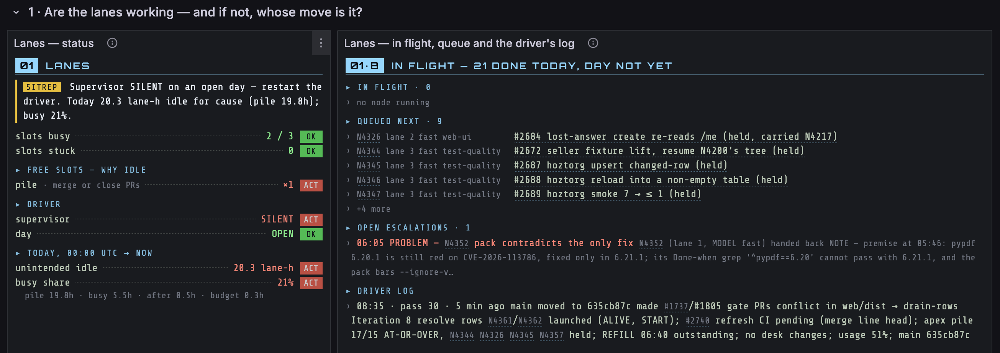

# eakot-mp

A [Claude Code plugin marketplace](https://docs.claude.com/en/docs/claude-code/plugin-marketplaces) of things
worth sharing. Every plugin here works in any repository and names none.

```
/plugin marketplace add eakot/eakot-mp
/plugin install grafana-sitrep@eakot-mp
```

| Plugin | What it does |
|---|---|
| [`grafana-sitrep`](plugins/grafana-sitrep/skills/sitrep-dashboard/SKILL.md) | Refactors a Grafana dashboard into "sitrep" status sheets: a monospace mission briefing whose first line is the verdict and the move, then a table of contents of every number (`label ..... value [OK/WARN/ACT]`), every repo, PR, issue, commit and workflow a link, beside history charts that cannot draw an impossible peak. The agent works in the operator's role: it asks the questions a reader asks of each panel and answers them from live data, and brings the human only the rulings (thresholds, what "today" means, what idle is intended). Needs the Business Text panel plugin. |

## What a sitrep page looks like



A live operator page made with `grafana-sitrep`, one row of two sheets:

- **The SITREP line comes first** (left). It names the verdict and the move: the supervisor is silent on an
  open day, so restart the driver.
- **Every number is a contents line**: `label ..... value [TAG]`. The tags mean the same on every sheet:
  `OK` fine, `WARN` look, `ACT` someone must act. Only `ACT` blinks.
- **Fixed-width fields lead each list line** (right): node id, lane, model, topic. The title then starts
  at the same column on every line, and the full task text shows on hover instead of being cut off.
- **Every id, PR and issue is a link**, dimmed when it is secondary. Colour means state and nothing else.
  The background is flat, and nothing decorative crosses the text.

## Adding a plugin

One directory under `plugins/<name>/` with a `.claude-plugin/plugin.json`, plus one entry in
`.claude-plugin/marketplace.json`. Run `claude plugin validate .` before pushing. A plugin that only makes
sense in one repository belongs in that repository's `.claude/`, not here.

## License

MIT — see [LICENSE](LICENSE).
