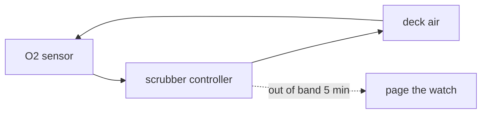

# Ship systems

The ship runs three control loops: life support, power and thermal. Each one has a sensor, a controller and an
alarm, and the bridge reads all three on one page. The decisions behind them are in [the ledger](adr/README.md).

## 1. Life support

Life support holds oxygen between 19.5 % and 23.5 % in every inhabited deck.

The scrubbers run on a duty cycle set by [ADR 0001](adr/0001-scrubber-duty-cycle.md). A deck that leaves the band
for more than five minutes pages the watch officer.

## 2. Power

The reactor feeds two buses, and a bus never carries more than 80 % of its rating.

| Bus | Rating | Feeds |
|---|---|---|
| A | 4 MW | life support, bridge |
| B | 6 MW | engines, thermal |

## 3. Where it stands

Life support and power are complete. Thermal is still a hand-run procedure; [ADR 0002](adr/0002-thermal-loop.md)
proposes automating it.
